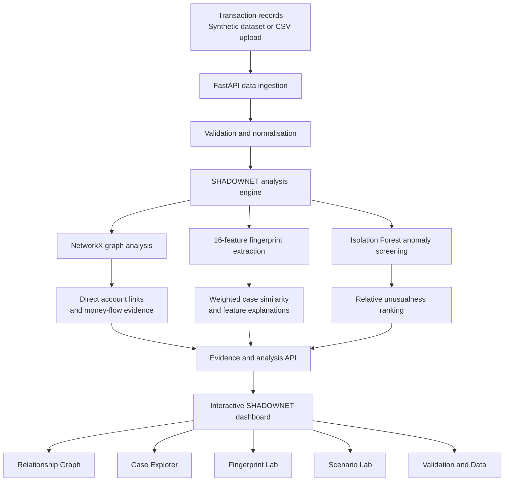

# SHADOWNET

**The Missing Link — AI-Assisted Cross-Case Financial Fraud Intelligence**

SHADOWNET is an investigative prototype that helps reveal potential relationships between separately reported financial incidents. It analyses transaction records across cases to identify shared account identifiers, compare suspicious money-movement behaviour and highlight transactions that are unusual within the supplied dataset.

Its central idea is simple: activity that looks ordinary when examined one case at a time may reveal useful connections when transactions and patterns are compared across cases.

## Problem statement

Financial investigations may involve multiple victims, accounts, intermediaries and institutions. When incidents are reviewed independently, links between cases can be difficult to notice. A shared account identifier may connect two records directly, while different account identifiers can still be associated with similar transaction-flow behaviour.

SHADOWNET brings these two forms of analysis into one evidence-oriented workspace.

## Proposed solution

The platform combines three analytical approaches:

1. **Direct account-link discovery** identifies account identifiers appearing in more than one case and presents the supporting transaction records.
2. **Suspicious Pattern Fingerprinting** compares cases with no shared account identifiers using a 16-feature representation of transaction behaviour.
3. **Anomaly screening** applies an Isolation Forest model to rank transactions by relative unusualness within the loaded dataset.

The results are presented through an interactive relationship graph and case-analysis workspace so that a reviewer can inspect why a connection or unusual transaction was surfaced.

## System architecture

The application follows a browser-client and Python API architecture. Transaction data flows through validation and analysis before evidence and results are returned to the dashboard.



### Main architectural components

- **Frontend:** HTML, CSS and JavaScript provide the interactive dashboard, case views, fingerprint comparisons and SVG-based relationship visualisation.
- **API layer:** FastAPI receives transaction uploads and serves overview, case, graph, comparison, anomaly, validation and scenario-analysis results.
- **Analysis engine:** validates and normalises transaction records, applies explicit account aliases, extracts case fingerprints and coordinates the analytical methods.
- **Graph analysis:** NetworkX represents account-to-account transfers as directed graphs, supports money-flow analysis and helps identify identifiers shared across cases.
- **Fingerprint engine:** derives 16 behavioural features for each case and calculates a weighted similarity score with feature-level explanations.
- **Anomaly screening:** scikit-learn's Isolation Forest provides a dataset-relative ranking of unusual transactions.
- **Evidence layer:** relationship records retain the transaction references and feature comparisons used to explain why a result was surfaced.

## Key modules and capabilities

### 1. Cross-case relationship graph

- Represents cases and their relationships in an interactive graph.
- **Direct links** are based on a shared canonical account identifier across case records.
- **Fingerprint links** represent behavioural similarity between cases that do not share account identifiers.
- Link evidence can be opened and inspected rather than relying on a score alone.

### 2. Suspicious Pattern Fingerprinting

Each case is represented by 16 features grouped into four families:

| Feature family | Features represented |
|---|---|
| Flow topology | Split-source share, maximum fan-out, maximum fan-in, pass-through share, network density and chain depth |
| Transaction tempo | Rapid-burst share, median gap between transactions and gap variation |
| Amount behaviour | Amount variation, rounded-amount share and top-recipient concentration |
| Reuse and timing | Reused-account share, consolidation share, night-time share and weekend share |

The engine compares feature values using feature-specific similarity functions and configurable weights. The default relationship threshold is **90/100**, and each case must contain at least **five transactions** to be eligible for fingerprint linking.

The Fingerprint Lab shows the score, individual feature similarities, strongest alignments and notable differences.

### 3. Transaction anomaly screening

- Uses **Isolation Forest**, an unsupervised machine-learning algorithm.
- Considers transaction amount, time, source and target account activity, and payment channel.
- Ranks records by relative unusualness within the currently loaded dataset.
- The prototype makes this screen available only when at least 25 transactions are loaded.

### 4. Case Explorer and money-flow analysis

- Displays case-level transaction details and account activity.
- Shows directed money movement between source and beneficiary accounts.
- Helps a reviewer trace the transaction sequence within an individual case.

### 5. Scenario Lab

Allows a reviewer to enter a new transaction sequence and compare its behavioural fingerprint with the loaded cases. The prototype requires at least five transactions before it returns nearest fingerprint matches.

### 6. Alias mapping and evidence provenance

The prototype supports explicit **operator-attested** account-alias mappings. Each mapping records the institution, original account ID, canonical account ID, operator and source reference. The mapped identifier can then be used in cross-case analysis.

This is a demonstration of a provenance-aware workflow: SHADOWNET does not independently authenticate the operator or source document, and the sample mapping is not bank-verified.

### 7. Validation and data controls

The bundled validation scenarios demonstrate:
- A known shared-account pair with transaction-level evidence.
- A disconnected pair designed to produce a high fingerprint similarity.
- A benign look-alike pair that remains below the configured threshold.
- A low-sample case blocked by the five-transaction minimum.

These are controlled synthetic examples used to demonstrate the intended behaviour of the prototype, not a real-world accuracy benchmark.

## Analytical methodology

### Direct account matching

The engine canonicalises account identifiers using only the explicit alias mappings supplied to it. It then checks whether a canonical account identifier appears in multiple cases. When it does, the resulting relationship includes the relevant transaction references and the account's role in each transfer.

### Behavioural similarity

For cases without a shared canonical account identifier, the engine extracts the 16-feature behavioural vector and calculates a weighted similarity score. Feature-level contributions are retained so that the score can be examined and explained.

A fingerprint score indicates resemblance in the supplied transaction patterns. It is not a probability of fraud, proof of common ownership or proof of a coordinated actor.

### Unsupervised anomaly ranking

Isolation Forest identifies records that are relatively unusual compared with the other records in the loaded dataset. Its output is a within-dataset ranking, not a labelled prediction or fraud probability.

## Technology stack

| Layer | Technologies |
|---|---|
| Backend API | Python, FastAPI, Uvicorn |
| Data processing | Pandas, NumPy |
| Graph analysis | NetworkX |
| Machine learning | scikit-learn, Isolation Forest |
| Frontend | HTML, CSS, JavaScript |
| Visualisation | SVG-based interactive graphs |
| Testing | Python unittest / API tests |

## Project structure

```text
SHADOWNET/
├── backend/
│   ├── main.py              # FastAPI routes and application state
│   └── engine.py            # Validation, graph and fingerprint analysis
├── data/
│   ├── synthetic_transactions.csv
│   └── generate_demo_data.py
├── demo_csvs/               # Focused and combined synthetic CSV examples
├── frontend/
│   ├── index.html
│   ├── app.js
│   ├── styles.css
│   └── aurora-theme.css
├── tests/                   # Engine and API tests
├── tools/                   # Diagnostic and local helper tools
├── requirements.txt
├── render.yaml
├── .gitignore
└── README.md
```

## Data format

The CSV analysis workflow expects these required columns:

```text
transaction_id, case_id, bank, timestamp,
source_account, target_account, amount
```

Optional columns include `channel`, `device_id` and `ip_hash`. The supplied demonstration records are fictional and are intended for evaluating the prototype's features.

## Scope and limitations

- The bundled cases and institutions are simulated; they are not real bank records or a labelled fraud dataset.
- Fingerprint features and weights are hand-engineered. Similarity scores are heuristic and are not calibrated probabilities.
- Isolation Forest provides unsupervised, dataset-relative unusualness rankings; it does not confirm fraud.
- Shared identifiers indicate overlap in the supplied records and require independent verification.
- Operator-attested alias entries are recorded with provenance, but the prototype does not independently validate the operator or source reference.
- The current prototype is a decision-support demonstration, not an automated fraud verdict or a production banking investigation system.

**SHADOWNET surfaces potential investigative leads for human review. It does not establish fraud, common ownership or criminal intent.**
